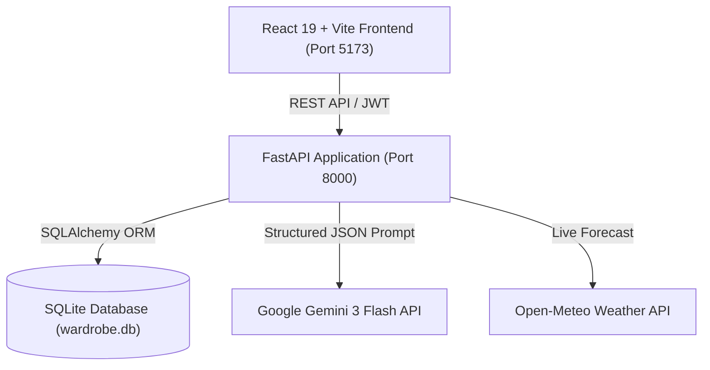

# AURA — AI-Powered Smart Wardrobe & Outfit Stylist

[](https://fastapi.tiangolo.com/)
[](https://react.dev/)
[](https://www.sqlite.org/)
[](https://ai.google.dev/)
[](#automated-testing)

A desktop-first smart wardrobe assistant that digitizes your physical clothes, checks real-time weather forecasts, and combines your own garments into stylish outfits using **Google Gemini 3 Flash** with strict database validation.

---

## Key Features

1. **Intelligent Digital Closet**
   - Catalog tops, bottoms, dresses, outerwear, footwear, and accessories.
   - Tag with colors (hex palette), patterns, formality levels (1-5), warmth ratings (1-5), fabrics, and seasonal tags.
   - Instant multi-filter search by category, color, occasion, and season.

2. **Google Gemini AI Stylist Engine**
   - Suggests complete ensembles for 8 occasions: *Casual, Office, Formal, Party, Date, Sports, Travel, and Festival*.
   - **Zero Invented Clothing**: Gemini output is strictly validated against the user's SQLite wardrobe. Any foreign or unowned item IDs are rejected.
   - **Anchor Item Flow**: "Build an outfit around this piece" feature allows locking a hero garment.
   - **Weather Intelligence**: Real-time weather fetched via Open-Meteo with automatic temperature adaptation and manual override.

3. **Calendar Outfit Planner**
   - 7-day Monday-to-Sunday weekly calendar.
   - Schedule saved or styled looks for specific dates with custom notes.
   - Duplicate schedule protection.
   - One-click **"Mark as Worn"** directly from the calendar.

4. **Feedback & Wear Tracking**
   - Like, Dislike, Save/Unsave, and "I Wore This" actions.
   - Wear tracking automatically increments `times_worn` and timestamps `last_worn`.
   - Compact feedback history is summarized into subsequent Gemini prompts to refine personalization over time.

5. **Wardrobe Insights & Analytics**
   - Wardrobe Utilization percentage calculation (`worn / total items`).
   - Category distribution breakdown charts.
   - Ranked **Most Worn** pieces with wear counts.
   - **Forgotten Gems Spotlight**: Surfaces zero-wear items with a 1-click **"Style It"** shortcut that pre-selects the forgotten piece as the anchor item in AI Stylist.

6. **Landing Page with 1-Click Demo Login**
   - Modern split-hero landing page with an integrated Sign In / Sign Up interface.
   - **1-Click Demo Access**: Instant login to the seeded demo wardrobe (`demo@wardrobe.com` / `demo12345`).

7. **Security & Data Privacy**
   - Password hashing with PBKDF2/Bcrypt and JWT Bearer token authentication.
   - Strict user data isolation: all queries scoped to authenticated `user_id`.
   - Local SQLite database storage — zero third-party telemetry.

---

## Architecture & Tech Stack



- **Frontend**: React 19, Vite, Tailwind CSS, Lucide React, Axios.
- **Backend**: FastAPI, SQLAlchemy ORM, Pydantic V2, Uvicorn, Python-Jose (JWT), Passlib (Bcrypt).
- **Database**: SQLite with foreign key cascades.
- **AI / LLM**: `google-genai` Python SDK (`gemini-3-flash-preview` / `gemini-3.5-flash-lite`).
- **Weather**: Open-Meteo Geocoding & Forecast APIs.

---

## Getting Started

### Prerequisites
- **Python 3.10+** (Tested on Python 3.12, 3.13, 3.14)
- **Node.js 18+** & npm

---

### Backend Setup

1. **Navigate to the backend directory**:
   ```bash
   cd backend
   ```

2. **Create and activate a virtual environment**:
   ```bash
   # Windows PowerShell
   python -m venv venv
   .\venv\Scripts\Activate.ps1

   # macOS / Linux
   python3 -m venv venv
   source venv/bin/activate
   ```

3. **Install dependencies**:
   ```bash
   pip install -r requirements.txt
   ```

4. **Configure environment variables**:
   Create a `.env` file in the `backend/` folder (or copy from `.env.example`):
   ```ini
   SECRET_KEY=aura_super_secret_development_key_2026
   ACCESS_TOKEN_EXPIRE_MINUTES=1440
   DATABASE_URL=sqlite:///./wardrobe.db
   UPLOAD_DIR=./uploads
   FRONTEND_ORIGIN=http://localhost:5173
   GEMINI_API_KEY=your_gemini_api_key_here
   GEMINI_MODEL=gemini-3-flash-preview
   ```

5. **Seed the demo database**:
   ```bash
   python scripts/seed.py
   ```
   *Creates the demo user (`demo@wardrobe.com` / `demo12345`), seeds 26 diverse wardrobe pieces across all 6 categories, and sets up initial preferences and sample looks.*

6. **Start the backend development server**:
   ```bash
   uvicorn app.main:app --host 127.0.0.1 --port 8000 --reload
   ```
   *Interactive Swagger documentation will be available at [http://127.0.0.1:8000/docs](http://127.0.0.1:8000/docs).*

---

### Frontend Setup

1. **Navigate to the frontend directory**:
   ```bash
   cd frontend
   ```

2. **Install npm dependencies**:
   ```bash
   npm install
   ```

3. **Start the Vite development server**:
   ```bash
   npm run dev
   ```
   *Open [http://127.0.0.1:5173](http://127.0.0.1:5173) in your browser.*

---

## Demo Credentials

For quick evaluation without manual data entry, use the pre-configured demo account:
- **Email**: `demo@wardrobe.com`
- **Password**: `demo12345`
- *Or click the **"1-Click Demo Login"** button directly on the Landing Page.*

---

## Automated Testing

The backend includes a comprehensive automated test suite covering all modules:

```bash
cd backend
.\venv\Scripts\pytest
```

**Test Coverage Summary (54 Passed)**:
- `test_auth.py` (8 tests): Registration, login, duplicate check, token validation, password update, user profile.
- `test_health.py` (2 tests): Backend service health check.
- `test_wardrobe.py` (7 tests): Item creation, multi-attribute filtering, editing, deletion, foreign item protection.
- `test_preferences.py` (5 tests): User onboarding, style preferences, color swatches, city updates.
- `test_weather.py` (5 tests): Open-Meteo geocoding, live forecast, temperature classification, error fallback.
- `test_outfits.py` (16 tests): Gemini structured output validation, prerequisite checks, anchor item enforcement, like/dislike mutual exclusivity, wear count increments, saved outfits pagination.
- `test_insights.py` (5 tests): Wardrobe category breakdown, wear utilization, most-worn sorting, forgotten gems.
- `test_planner.py` (6 tests): Weekly calendar scheduling, duplicate schedule updates, date filtering, unscheduling, user isolation.

---

## API Endpoints Summary

| Method | Endpoint | Description |
| :--- | :--- | :--- |
| `POST` | `/api/v1/auth/register` | Register new user account |
| `POST` | `/api/v1/auth/login` | Login and obtain JWT access token |
| `GET` | `/api/v1/auth/me` | Get authenticated user profile |
| `PATCH`| `/api/v1/auth/me` | Update user display name |
| `DELETE`| `/api/v1/auth/me` | Permanently delete user account |
| `GET` | `/api/v1/preferences` | Retrieve styling preferences & city |
| `PUT` | `/api/v1/preferences` | Update styling preferences & onboarding |
| `GET` | `/api/v1/wardrobe/items` | List & filter wardrobe items |
| `POST` | `/api/v1/wardrobe/items` | Add clothing item with attributes & image |
| `GET` | `/api/v1/wardrobe/items/{id}`| Get clothing item details |
| `PUT` | `/api/v1/wardrobe/items/{id}`| Update clothing item |
| `DELETE`| `/api/v1/wardrobe/items/{id}`| Delete clothing item & associated links |
| `GET` | `/api/v1/weather?city=...` | Fetch live weather for a city |
| `POST` | `/api/v1/outfits/suggest` | Generate Gemini outfit combinations |
| `POST` | `/api/v1/outfits/{id}/feedback` | Like, dislike, save, or mark outfit worn |
| `GET` | `/api/v1/outfits/saved` | List saved, liked, or historical outfits |
| `GET` | `/api/v1/planner` | Get scheduled outfits by date range |
| `POST` | `/api/v1/planner` | Schedule an outfit on a calendar date |
| `DELETE`| `/api/v1/planner/{id}` | Unschedule a planned outfit |
| `GET` | `/api/v1/insights/summary`| Get wardrobe utilization, categories & analytics |

---

## License
MIT License. Created for the AURA Personalized AI Wardrobe project.
