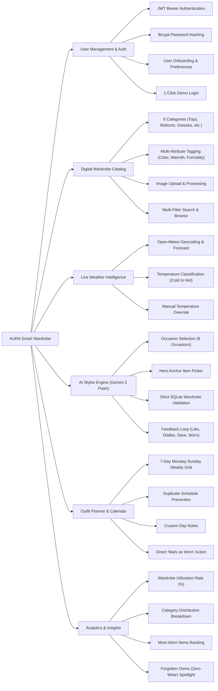
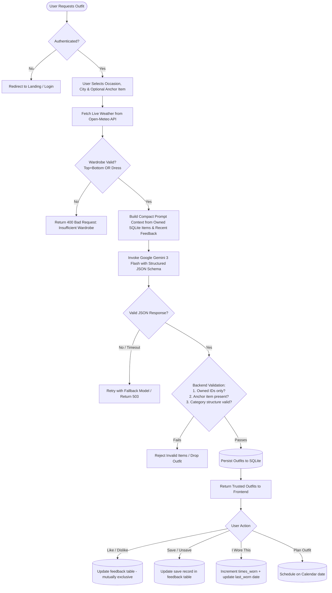
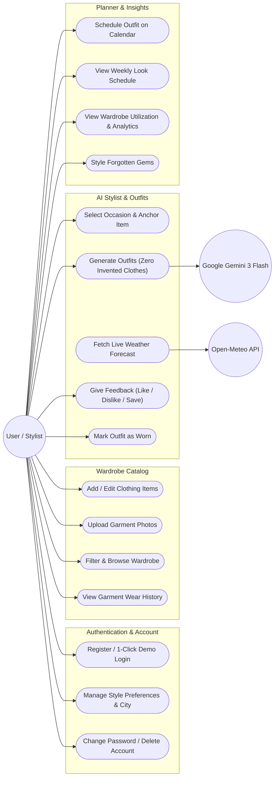
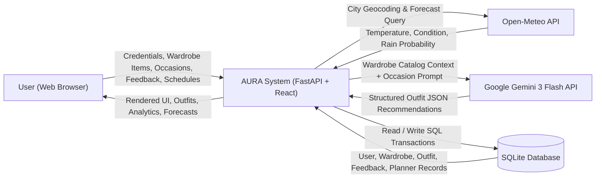
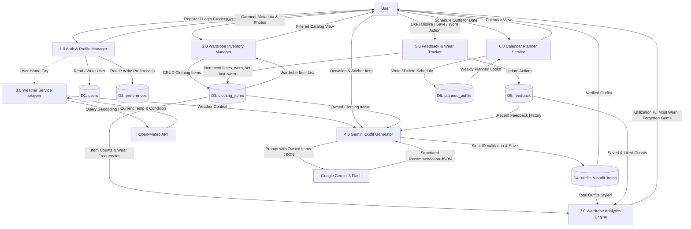
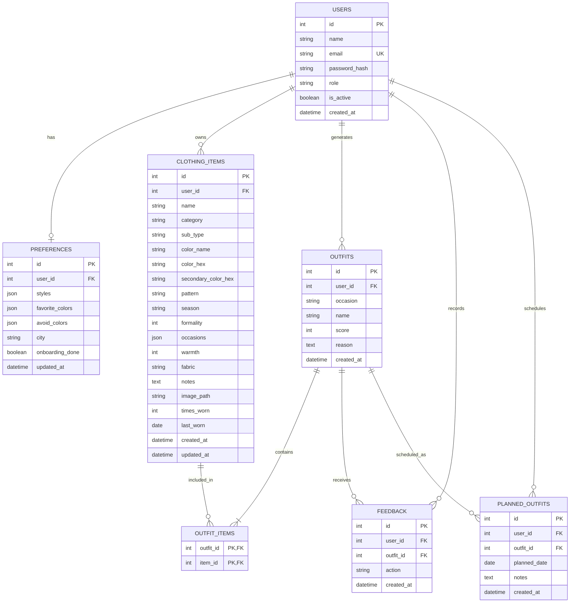
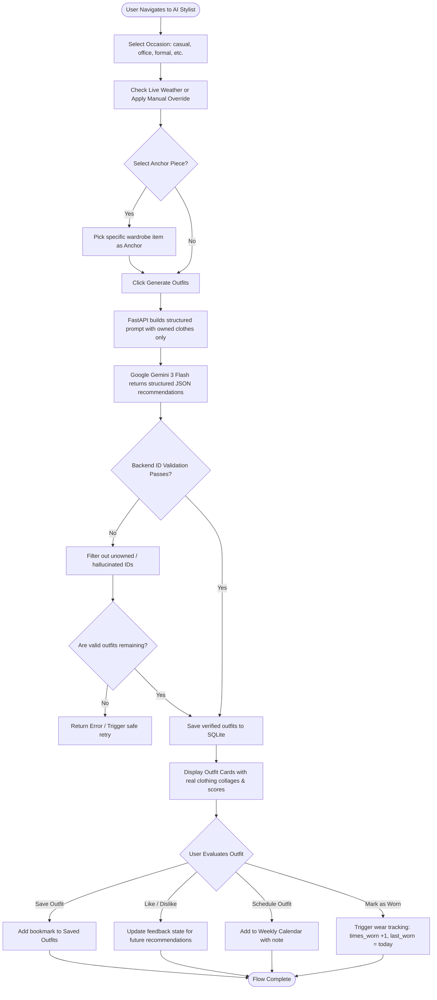
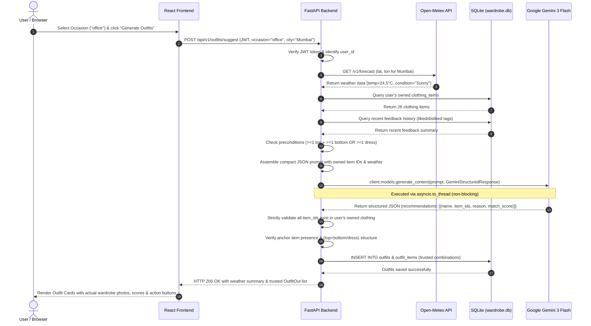
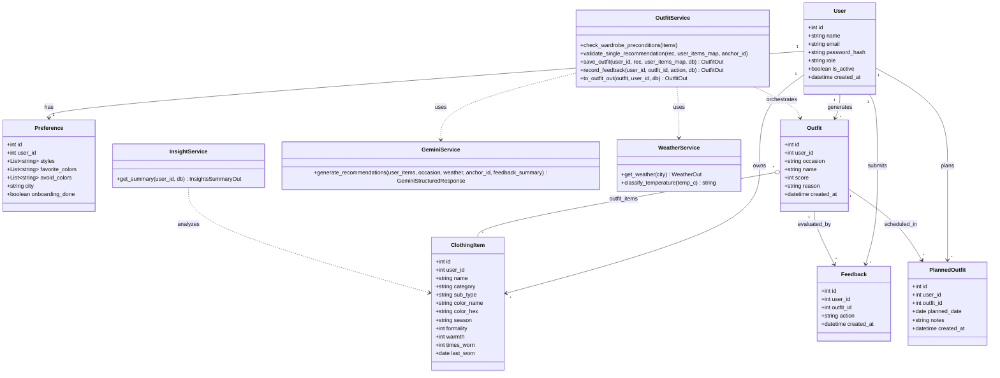
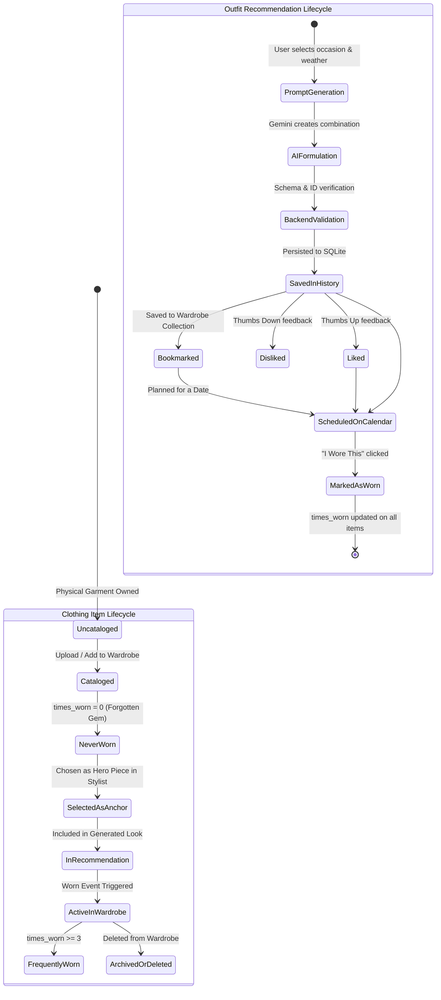

# AURA System Architecture & Design Diagrams

This document contains the complete technical design and architectural diagrams for **AURA — AI-Powered Smart Wardrobe & Outfit Stylist**.

---

## 1. Mind Map Diagram (System Architecture & Modules)

---

## 2. System Flowchart (Outfit Recommendation & Feedback Pipeline)

---

## 3. Use Case Diagram

---

## 4. Data Flow Diagrams (DFD)

### Level 0: Context Diagram

### Level 1: Decomposition Diagram

---

## 5. Entity Relationship Diagram (ERD)

---

## 6. Activity Diagram (Outfit Recommendation & Wear Cycle)

---

## 7. Sequence Diagram (End-to-End Recommendation Call)

---

## 8. Class Diagram (Backend Architecture)

---

## 9. State Diagram (Clothing Item & Outfit Lifecycle)

